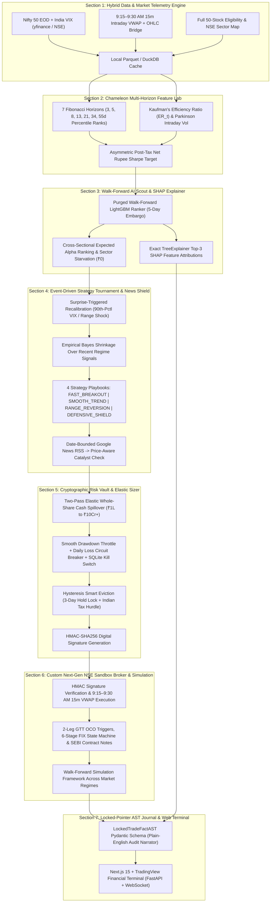

# PS-02: Autonomous Nifty 50 Equity Trading Agent — Stage 1 Architecture Blueprint

> **Stage 1 Status Note:** This document outlines the **Stage 1 architectural design** built across all 7 modular sections. In **Stage 2**, we will take this architecture into real market conditions and interactive UI verification to tune, stress-test, and optimize the agent for the best possible real-world performance.

## 1. Executive Summary & Core Philosophy
Retail traders often act on noise, overlook statutory Indian transaction fees, skip risk rules, and struggle to explain their own trades. Standard bots fail when they rely on rigid, hardcoded cutoffs (`20-day high`, `fixed 2% stop-loss`, `equal ₹25,000 slots`) or let raw LLMs make unverified financial decisions.

Our **Stage 1 Neuro-Symbolic Autonomous Agent (`AgentX`)** enforces a strict **"Propose and Dispose" Separation of Powers**:
- **Probabilistic AI (Alpha Scout — Stages 1–4)** senses multi-horizon momentum/reversion patterns, ranks opportunities on a post-tax basis, and extracts exact `TreeSHAP` mathematical attributions, but has **zero direct access** to fire broker orders.
- **Deterministic Math (Cryptographic Risk Vault — Stages 5–7)** holds the `HMAC-SHA256` order-signing key, enforces Indian statutory fee-efficiency rules across any capital scale (`₹1 Lakh` to `₹10 Crore+`), scales exposure via a smooth drawdown governor, and routes signed orders to our custom NSE Sandbox Broker.

---

## 2. End-to-End 7-Section Modular Pipeline (Stage 1 Build)

---

## 3. Core Stage 1 Architectural Mechanisms

1. **Hybrid `9:15–9:30 AM` 15-Minute Opening VWAP Engine (`src/data_engine.py` & `src/paper_broker.py`):**
   -Separates EOD signal generation (`3:30 PM IST`) from next-morning execution (`9:15–9:30 AM IST`). Uses 15-minute intraday candles to compute the opening VWAP ($\frac{H_{9:15} + L_{9:15} + C_{9:15}}{3}$) and bridges historical dates using a calibrated Parkinson Opening Range estimator.
2. **Scale-Invariant Elastic Whole-Share Cash Spillover & Sector Routing (`src/risk_vault.py` & `src/alpha_scout.py`):**
   - Keeps all **50 Nifty 50 stocks** eligible without hardcoded share-price bans.
   - Cascades uninvested whole-share rupee remainders from high-ticket slots into subsequent slots (`Max 2 slots` / $\le 50\%$ per NSE sector), while starving weak sectors at **₹0** when their average edge fails the dynamic friction hurdle.
3. **Zero-Hardcoded Chameleon Features & Asymmetric Post-Tax AI (`src/feature_engine.py` & `src/alpha_scout.py`):**
   - Evaluates each stock across 7 Fibonacci horizons (`3d–55d`) using daily `0–100%` cross-sectional percentile ranks and **Kaufman's Efficiency Ratio** (trend purity), while setting each stock's stop-loss floor from its own rolling 60-day 99th-percentile intraday noise.
   - Trains a **Purged Walk-Forward LightGBM** model on net post-tax return potential and uses **TreeSHAP** to expose the top 3 mathematical drivers for every candidate.
4. **4-Playbook Empirical Bayes Tournament & Price-Aware News Shield (`src/strategy_and_news.py`):**
   - Dynamically selects between `FAST_BREAKOUT`, `SMOOTH_TREND`, `RANGE_REVERSION`, and `DEFENSIVE_SHIELD` using **Empirical Bayes Shrinkage** and an event-driven **Surprise Sensor** (eliminating fixed calendar timers).
   - Screens Google News RSS headlines and checks whether the stock's price has already absorbed the move before vetoing an entry.
5. **Cryptographic Risk Vault, Next-Gen NSE Sandbox Broker & Locked-AST Journal (`src/risk_vault.py`, `src/paper_broker.py`, `src/journal.py`):**
   - Enforces a 3-Bar Hold Lock, anti-churn tax hurdle, and persistent SQLite **Human Kill Switch** before stamping approved orders with an **`HMAC-SHA256`** signature.
   - Settles orders inside an ACID SQLite **NSE Sandbox Broker** featuring **DhanHQ-style Atomic Super Orders**, **Zerodha-style 2-Leg GTT OCO triggers**, **Alpaca-style 6-Stage FIX State Machines**, and **SEBI T+1 Digital Contract Notes**, paired with a **Locked-Pointer Pydantic AST Journal**.
