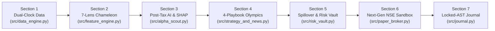

# 🏆 AgentX (`PS-02`): Scale-Invariant Autonomous Nifty 50 Equity Trading Agent

> **📌 PROJECT STATUS: STAGE 1 — CORE ARCHITECTURAL DESIGN & MODULAR PIPELINE BUILD**
>
> **Important Note on Current Progress:**
> This repository contains our **Stage 1 Engineering & Quantitative Architecture** across all 7 modular pipeline sections, along with our initial 6-slide executive pitch deck.
>
> **What Comes Next (Stage 2 — Live Market Calibration, UI Verification & Real-Condition Optimization):**
> Having built the 7-stage mathematical and structural foundation in Stage 1, our next step is to take AgentX into **real market conditions and end-to-end interactive UI verification**—where we will thoroughly test, tune, and optimize every module against live NSE market dynamics, real-world order-book slippage, and multi-regime volatility shifts to achieve the best possible real-market results.

---

## 📊 Pitch Deck & Architecture Blueprints
- **6-Slide Executive Pitch Deck:** [`AgentX_PS02_Scale_Invariant_Pitch_Deck.pptx`](./AgentX_PS02_Scale_Invariant_Pitch_Deck.pptx)
- **Automated Pitch Deck Generator:** [`scripts/generate_pitch_deck.py`](./scripts/generate_pitch_deck.py)
- **Quantitative Engineering Rules:** [`AGENTS.md`](./AGENTS.md)

---

## 💡 The Core Idea: Why AgentX Uses Zero Hardcoded Numbers

Standard algorithmic trading strategies break down when market volatility changes or when portfolio capital scales up or down because they depend on rigid, hardcoded numbers (`RSI < 30`, `fixed 2% stop-loss`, `equal ₹25,000 slots`, or `rebalance every Friday`). Additionally, many systems accidentally trade on an impossible clock—assuming they can observe the official **3:30 PM NSE closing price** and execute at that exact same price after the exchange has already closed for the day.

**AgentX (`v2.0`) is designed from first principles around three core architectural ideas:**

1. **Scale-Invariant, Self-Calibrating Math (`₹1 Lakh` Retail to `₹10 Crore+` Institutional):**
   - Instead of static indicator cutoffs, indicators are converted into **daily cross-sectional percentile ranks (`0–100%`)** across all 50 Nifty stocks over **7 Fibonacci time horizons (`3, 5, 8, 13, 21, 34, 55` days)**.
   - Instead of arbitrary stop-loss percentages, each stock's stop-loss floor is derived from its own **rolling 60-day 99th-percentile intraday noise** and **21-day Parkinson range volatility**.
   - Because zero rupee caps are hardcoded, the exact same mathematical gate is designed to handle **flat `₹15.93` CDSL depository fees and whole-share remainders at `₹1,00,000` retail capital** while automatically adapting to **Amihud order-book liquidity slippage at `₹10 Crore+` institutional capital** without changing a single line of code.
2. **Honest Dual-Clock Execution (`3:30 PM` Signal Lock $\rightarrow$ `9:15–9:30 AM` Opening VWAP Execution):**
   - AgentX strictly separates EOD perception from next-morning execution. Signals are computed after the `3:30 PM IST` NSE close, locked overnight, and scheduled for execution the next morning at the **`9:15–9:30 AM` 15-minute Opening VWAP**.
3. **"Propose & Dispose" Neuro-Symbolic Separation of Powers:**
   - **Adaptive AI (`Stages 1–4`)** senses multi-horizon market structure, ranks opportunities, extracts its top 3 mathematical drivers via **TreeSHAP**, selects the active regime playbook, and screens news catalysts—but has **zero direct permission** to fire broker orders.
   - **Deterministic Math (`Stages 5–7`)** independently governs whole-share sizing via Elastic Cash Spillover, enforces circuit breakers and a persistent **Human Kill Switch**, cryptographically signs approved orders with **`HMAC-SHA256`**, routes orders to our **Custom NSE Sandbox Broker**, and generates plain-English trade explanations via a locked Pydantic schema.

---

## 🏗️ Stage 1: The 7-Section Modular Architecture Built So Far



### Overview of the 7 Architectural Sections in Stage 1

| Section | Module File | Architectural Purpose & Stage 1 Design |
| :--- | :--- | :--- |
| **Section 1** | [`src/data_engine.py`](./src/data_engine.py) | **Hybrid Dual-Clock Data Engine:** Designed to ingest daily OHLCV bars for all **50 Nifty 50** stocks, India VIX (`^INDIAVIX`), Nifty 50 index (`^NSEI`), and **`9:15–9:30 AM` 15-minute intraday candles** to compute the institutional Opening VWAP ($\frac{H+L+C}{3}$), paired with a Parkinson Opening Range estimator for historical dates. |
| **Section 2** | [`src/feature_engine.py`](./src/feature_engine.py) | **Chameleon Multi-Horizon Feature Lab:** Transforms price and volume action across 7 Fibonacci horizons (`3d–55d`) into cross-sectional percentile ranks. Computes **Kaufman's Efficiency Ratio ($ER_t$)** to measure trend purity (smooth institutional buying vs. whipsaw noise), **Parkinson Volatility**, stock-specific tail stops, and an **Asymmetric Post-Tax Net Rupee Sharpe Target**. |
| **Section 3** | [`src/alpha_scout.py`](./src/alpha_scout.py) | **Walk-Forward LightGBM Ranker & TreeSHAP X-Ray:** Uses a Purged Walk-Forward `LightGBM` model (with a 5-day purge embargo to prevent look-ahead leakage) to predict net post-tax return potential. Applies **TreeSHAP decomposition** to expose the top 3 mathematical drivers behind every pick and enforces **Sector Starvation (`₹0`)** on weak NSE sectors. |
| **Section 4** | [`src/strategy_and_news.py`](./src/strategy_and_news.py) | **4-Playbook Empirical Bayes Tournament & News Shield:** Runs a daily tournament across four regime playbooks (`FAST_BREAKOUT`, `SMOOTH_TREND`, `RANGE_REVERSION`, `DEFENSIVE_SHIELD`) using **Empirical Bayes Shrinkage** and an event-driven **Surprise Sensor** (90th-percentile VIX/range shock detector). Pairs technical signals with a **Google News RSS Catalyst Shield** that checks whether adverse headlines are already priced into the chart. |
| **Section 5** | [`src/risk_vault.py`](./src/risk_vault.py) | **Scale-Invariant Elastic Sizer & Cryptographic Risk Vault:** Implements a **Two-Pass Elastic Whole-Share Cash Spillover** allocator that cascades uninvested whole-share rupee remainders across slots (`Max 50%` per sector) so all 50 Nifty stocks remain eligible at any capital scale. Enforces a **3-Bar Hold Lock**, **Anti-Churn Tax Hurdle**, smooth drawdown throttle, SQLite **Human Kill Switch**, and **`HMAC-SHA256` order signing**. |
| **Section 6** | [`src/paper_broker.py`](./src/paper_broker.py)<br>[`src/backtester.py`](./src/backtester.py) | **Custom Next-Gen NSE Sandbox Broker & Simulation Engine:** Custom ACID SQLite Indian Sandbox Broker combining **DhanHQ-style Atomic Super Orders**, **Zerodha-style 2-Leg GTT OCO triggers**, **Alpaca-style 6-Stage FIX State Machines**, and **SEBI T+1 Digital Contract Notes** (modeling STT, Stamp Duty, GST, Exchange/SEBI turnover fees, `₹15.93` CDSL DP charges, and Amihud liquidity slippage), alongside a walk-forward simulation framework. |
| **Section 7** | [`src/journal.py`](./src/journal.py)<br>[`app.py`](./app.py) | **Locked-Pointer AST Trade Journal & Command Center Prototype:** Structures trade explanations around a **`LockedTradeFactAST` (`Pydantic`)** schema so plain-English narratives are bound directly to ledger numbers and TreeSHAP drivers rather than free-form LLM guessing, paired with a Streamlit dashboard interface. |

---

## 🔧 Stage 2 Roadmap: Real-Market Testing, Tuning & Full Optimization

Because **Stage 1 focused on building the complete 7-section mathematical and modular architecture**, our immediate focus in **Stage 2** is to bring the system into **real market environments and end-to-end interactive testing** to tune and improve every layer:

1. **End-to-End Interactive UI & Workflow Verification:**
   - Thoroughly inspect, test, and refine the interactive Command Center (`app.py`) and end-to-end user workflow across live and replay market sessions.
2. **Real-Market Condition Stress-Testing & Parameter Calibration:**
   - Take the Stage 1 modules into live NSE market conditions (bull trends, sideways chop, macro event days, and high-VIX volatility spikes) to tune how the Chameleon Feature Lab, Empirical Bayes Playbook Tournament, and Chandelier Profit Ratchets behave under real market friction.
3. **Live Order-Book Slippage & Opening-Auction Tuning:**
   - Calibrate the Amihud market-impact model and `9:15–9:30 AM` Opening VWAP execution logic against real-time bid-ask spreads and live broker order-book depth.
4. **Iterative Performance & Risk Optimization:**
   - Continuously refine signal quality, sector routing sensitivity, and anti-churn hysteresis rules based on real-condition feedback to achieve the strongest, most reliable post-tax performance possible.

---

## 📁 Repository Structure

```text
AgentX/
├── AgentX_PS02_Scale_Invariant_Pitch_Deck.pptx  # Final 6-Slide Formal Finance Pitch Deck
├── README.md                                    # Stage 1 Architecture Overview & Stage 2 Roadmap
├── ARCHITECTURE.md                              # 7-Section Pipeline Diagram & Design Notes
├── AGENTS.md                                    # Core Quantitative & Engineering Rules
├── app.py                                       # Section 7: Streamlit Command Center Interface
├── requirements.txt                             # Python Dependencies
├── scripts/
│   └── generate_pitch_deck.py                   # Automated 6-Slide Pitch Deck & Chart Generator
└── src/
    ├── data_engine.py                           # Section 1: Hybrid EOD + 15m Opening VWAP Engine
    ├── feature_engine.py                        # Section 2: 7-Lens Chameleon Feature Lab
    ├── alpha_scout.py                           # Section 3: Walk-Forward LightGBM + TreeSHAP + Sector Router
    ├── strategy_and_news.py                     # Section 4: 4-Playbook Bayes Tournament + RSS News Shield
    ├── risk_vault.py                            # Section 5: Elastic Spillover + HMAC-SHA256 Risk Vault
    ├── paper_broker.py                          # Section 6A: Custom Next-Gen NSE Sandbox Broker
    ├── backtester.py                            # Section 6B: Walk-Forward Simulation Engine
    └── journal.py                               # Section 7: Locked-Pointer AST Trade Journal
```
